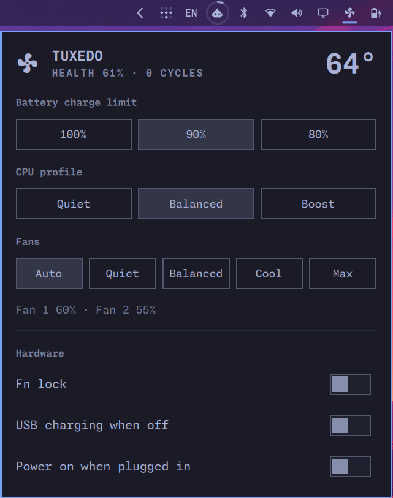

# TUXEDO Control for Omarchy

An [Omarchy](https://omarchy.org/) bar widget that does what TUXEDO Control
Center does on Uniwill-based TUXEDO laptops, inside the Omarchy shell.



- **Battery charge limit** — 100% / 90% / 80% (firmware charging profiles)
- **CPU profile** — Quiet / Balanced / Boost (embedded-controller power mode)
- **Fans** — Auto (firmware) or temperature curves: Quiet, Balanced, Cool, Max
- **Hardware** — Fn lock, USB charging while off, power on when plugged in
- CPU temperature, fan speeds and battery health at a glance

Tested on a TUXEDO InfinityBook Pro AMD Gen9 (board `GXxHRXx`) with
`tuxedo-drivers` 4.22. Other Uniwill models exposing `/dev/tuxedo_io` should
work; sections the hardware lacks are hidden.

## How it works

```
Panel.qml ──reads──▶ /run/tuxctl/status.json ◀──writes── tuxctl daemon (root)
    └──sudo -n tuxctl set KEY VALUE──▶ sysfs / tuxedo_io ioctl, /etc/tuxctl/state.json
```

`backend/tuxctl` is one Python script with no dependencies:

- `tuxctl daemon` — systemd service. Re-applies saved settings at boot, runs
  the fan curves (re-evaluated every ~2 s, every curve reaches 100% by 90 °C),
  publishes status for the panel, and hands the fans back to the firmware on
  exit.
- `tuxctl set KEY VALUE` — validates against a whitelist, applies, persists.
  The installer lets your user run only this subcommand via passwordless sudo.
- `tuxctl status` — print the status JSON.

## Requirements

- Omarchy with the Quickshell-based shell
- [`tuxedo-drivers`](https://gitlab.com/tuxedocomputers/development/packages/tuxedo-drivers)
  (`tuxedo_io` and `tuxedo_keyboard` modules loaded)
- `/usr/bin/python3`
- Not TUXEDO Control Center at the same time: both drive the fans.

## Install

```bash
omarchy plugin add https://github.com/vadim-su/omarchy-tuxedo-control --enable
sudo ~/.config/omarchy/plugins/kosto.tuxedo/backend/install.sh
```

`install.sh` copies `tuxctl` to `/usr/local/bin`, installs and starts
`tuxctl.service`, and writes `/etc/sudoers.d/tuxctl`. Re-run it after
updating `backend/tuxctl`.

## Uninstall

```bash
sudo systemctl disable --now tuxctl.service
sudo rm /etc/systemd/system/tuxctl.service /usr/local/bin/tuxctl /etc/sudoers.d/tuxctl
sudo rm -r /etc/tuxctl
omarchy plugin remove kosto.tuxedo
```

## Notes

- The CPU profile is the laptop firmware's power mode; it is independent of
  Omarchy's power profile (`power-profiles-daemon`, which only sets the
  `amd-pstate` EPP hint on these machines).
- The first switch from Auto to a curve takes ~15 s while the driver programs
  the firmware fan table.
- Translations: English and Russian (`i18n/`).

## License

MIT
